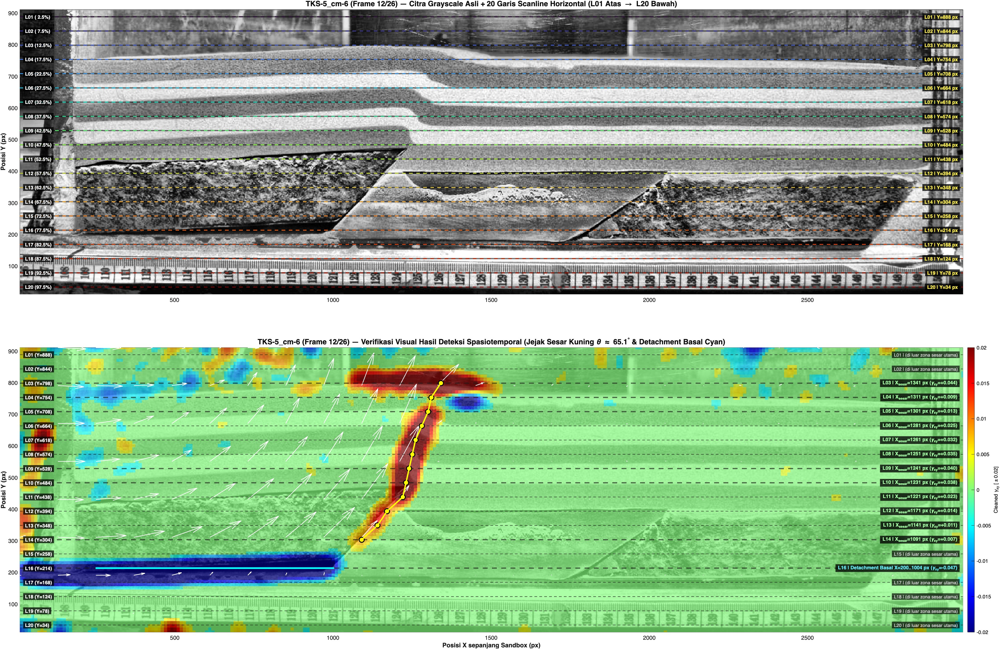
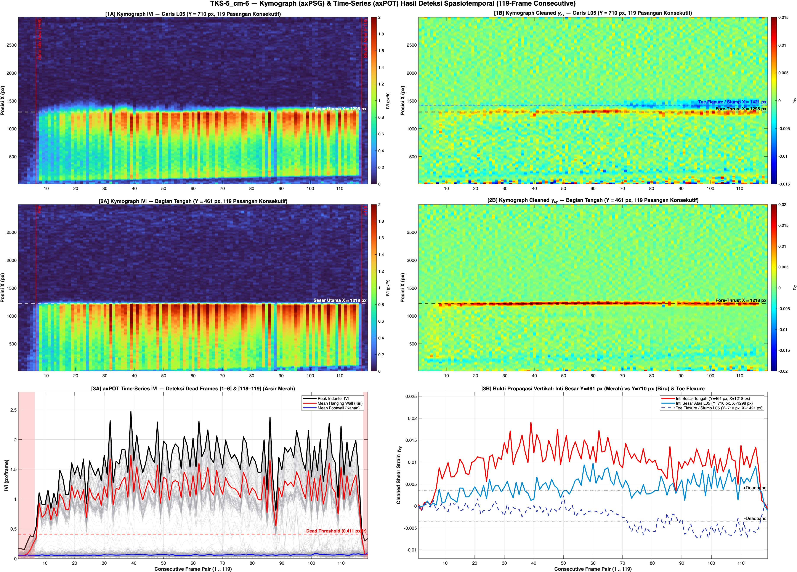
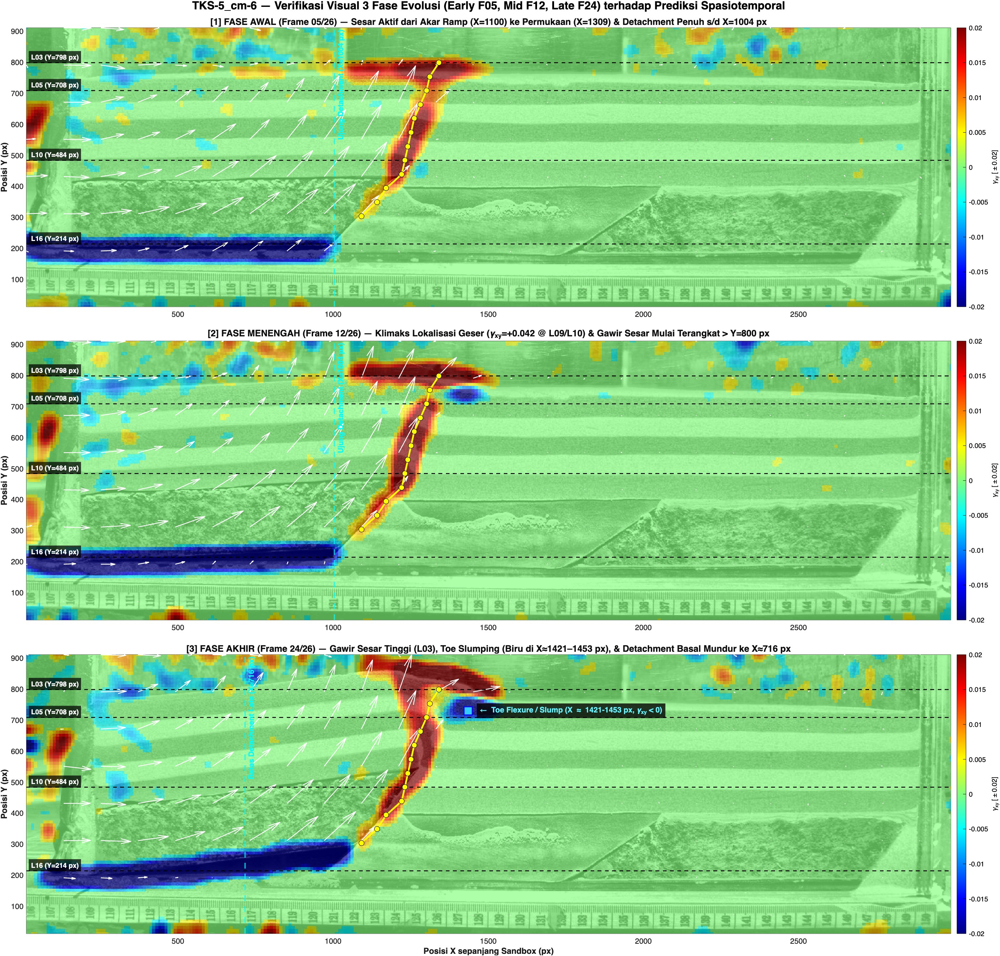
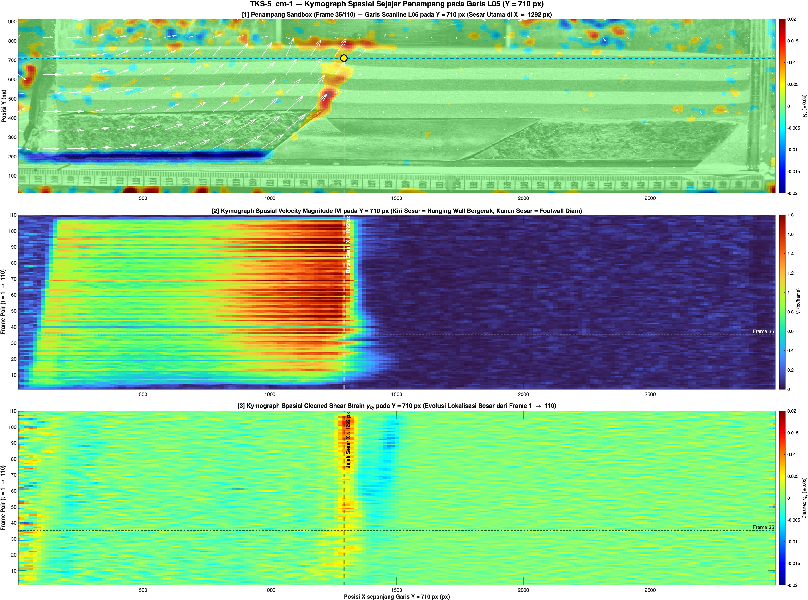

# PIV Kymograph Fault Detection

**Automated Spatiotemporal Fault, Scarp, and Basal Detachment Tomography via 20-Line Kymograph (`axPSG`) & Time-Series (`axPOT`) Scanning for Analog Tectonic Sandbox Modeling (GRAIN Ecosystem)**

---

## Ringkasan Arsitektur

Repositori ini menyediakan paket skrip MATLAB untuk melakukan **tomografi spasiotemporal 20 garis horizontal (`L01` s/d `L20`)** pada eksperimen pemodelan analog kotak pasir (*sandbox tectonic modeling*) berbasis *Particle Image Velocimetry* (PIV):

1. **Deteksi Temporal Konsekutif (`axPOT` & QPIV Thin-Strip):**
   - Mengekstrak deret waktu kecepatan puncak $\max(|V|)$ sepanjang garis pemindaian untuk mendeteksi secara otomatis *dead frames* (motor diam di awal/akhir eksperimen atau jeda *stick-slip*).
2. **Tomografi Spasiotemporal 20 Garis Horizontal (`L01` Atas $\rightarrow$ `L20` Bawah):**
   - Memindai matriks 2D Kymograph (`axPSG`: Posisi $X \times \text{Frame } t$) untuk **Velocity Magnitude ($|V|$)**, komponen kecepatan $(U, V_y)$, dan **Cleaned Symmetric Engineering Shear Strain ($\gamma_{xy} = \partial u/\partial y + \partial v/\partial x$, Filter Level 2: Median $3\times3$ + Gaussian $\sigma = 1.8$ px + Deadband $\pm0.0035$)** pada 20 elevasi horizontal ($2.5\%$ hingga $97.5\%$ dari atas).
3. **Deteksi Buta (*Blind Spatiotemporal Detection*) Tanpa Melihat Citra:**
   - **Jejak Sesar Naik Utama (*Main Fore-Thrust Trace*):** Melacak lokus puncak $+\gamma_{xy}(Y, t)$ dan diskontinuitas kecepatan horizontal $\partial u/\partial x$ dari akar ramp (`L15/L14`) hingga permukaan bebas (`L03`), termasuk regresi otomatis sudut kemiringan sesar ($\theta_{\text{dip}}$).
   - **Pertumbuhan Gawir Sesar (*Fault Scarp Uplift*) & *Toe Flexure / Slumping*:** Mendeteksi kapan puncak *hanging wall* terangkat menembus elevasi permukaan awal melalui lonjakan kecepatan vertikal $\max(V_y)$ di `L03`, serta lokalisasi geser negatif ($-\gamma_{xy}$) di kaki depan gawir (`L04–L05`).
   - **Horison Detachment Basal (`L16`):** Mengidentifikasi kedalaman dan jangkauan horizontal bidang gelincir dasar ($\gamma_{xy} \ll -0.025$) serta evolusi pergeseran ujung depannya dari fase awal ke fase akhir.

---

## Daftar Skrip Utama

| Berkas Skrip | Fungsi Utama |
| :--- | :--- |
| `piv_kymograph_fault_detection.m` | **Fungsi Master Generik**: Menjalankan tomografi spasiotemporal 20 garis horizontal (`L01..L20`), klasifikasi zona otomatis, kalkulasi sudut dip sesar ($\theta_{\text{dip}}$), ekspor tabel CSV/MAT, dan peta verifikasi JPG untuk berkas `.mat` PIV apa pun. |
| `setup_20_horizontal_lines.m` | Membangun tata letak 20 garis scanline horizontal (`L01`–`L20`) di atas citra *grayscale* CLAHE dan overlay *Cleaned Shear Strain* $\gamma_{xy}$ beserta titik potong sesar per garis. |
| `run_psg_kymograph_pot.m` | Ekstraksi penuh Kymograph (`axPSG`) dan *Plot Over Time* (`axPOT`) pada garis tengah (`y = 50%`) dan garis PSG (`y ≈ 70%`), termasuk komparasi *QPIV Thin-Strip* (`GRAIN0`). |
| `run_kymo_y710.m` | Analisis fokus Kymograph (`axPSG`) & Time-Series (`axPOT`) serta Kymograph Spasial Sejajar Penampang pada garis `Y = 710 px` (`L05`, `22.5%` dari atas). |
| `analyze_spatiotemporal_TKS5_6.m` | Algoritma deteksi spasiotemporal murni (*blind numerical detection*) 119 pasangan konsekutif + tomografi 20 garis pada eksperimen `TKS-5_cm-6.mat`. |
| `render_TKS5_6_verification_jpgs.m` | Merender 3 dashboard JPG verifikasi visual terhadap hasil deteksi spasiotemporal `TKS-5_cm-6` (`20 Garis L01-L20`, `Dashboard Kymograph 119-Frame`, dan `Evolusi 3 Fase Early-Mid-Late`). |

---

## Contoh Penggunaan Cepat (MATLAB)

```matlab
% 1. Tambahkan path GRAIN dan jalankan fungsi master pada kontainer PIV .mat
addpath('/path/to/GRAIN');
grain_setup();

report = piv_kymograph_fault_detection( ...
    '/Volumes/Tora 400gb/EXP_coll/TKS/5 cm/PIV_2026-06-24/TKS-5_cm-6-NOVL-S1-120to28-4p20px.mat', ...
    'NumLines', 20, ...
    'SpacingPx', 16, ...
    'ShearDeadband', 0.0035, ...
    'RenderFigures', true);

% 2. Atau jalankan deteksi spasiotemporal penuh + verifikasi visual TKS-5_cm-6:
analyze_spatiotemporal_TKS5_6();
render_TKS5_6_verification_jpgs();
```

---

## Galeri Hasil Verifikasi (`examples/`)

### 1. Tomografi 20 Garis Horizontal & Deteksi Sesar (`TKS-5_cm-6`)


### 2. Kymograph (`axPSG`) & Time-Series (`axPOT`) 119-Frame Konsekutif (`TKS-5_cm-6`)


### 3. Verifikasi Evolusi 3 Fase (`Early F05`, `Mid F12`, `Late F24` — `TKS-5_cm-6`)


### 4. Kymograph Spasial Sejajar Citra pada `Y = 710 px` (`L05` — `TKS-5_cm-1`)

